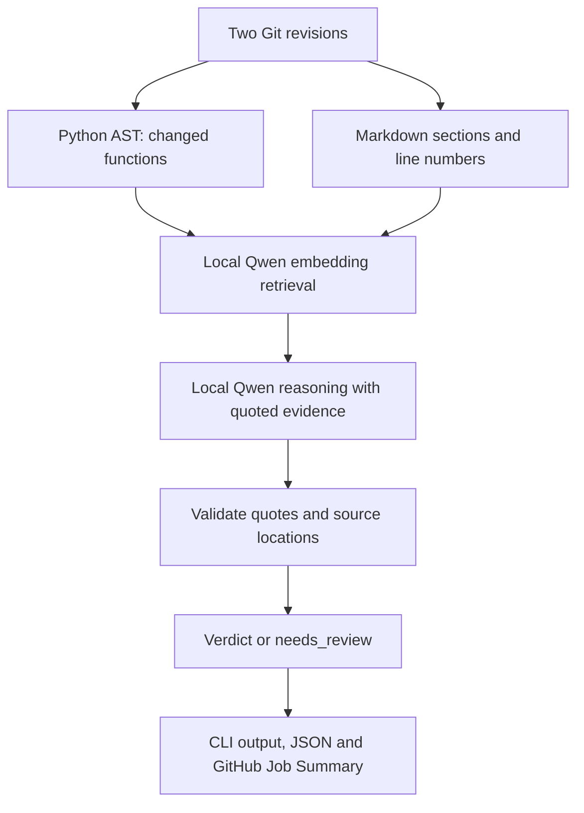

# VIGILANT

VIGILANT detects documentation drift in Python projects. Between two Git revisions, it
finds changed functions, retrieves the most relevant Markdown documentation with a local
embedding model, and asks a local reasoning model for a verdict with quoted evidence.

All inference runs on your machine. VIGILANT uses no hosted APIs or API keys.

> **Experimental:** Qwen2.5-Coder-7B-Instruct is a selected candidate, not a
> production-proven model. Check the evidence behind each verdict before acting on it. See
> [known limitations](#known-limitations).

## Verified live demo

See [the completed GitHub PR scan and screenshots](examples/live-pr-scan/README.md):
code changes timeout from 30 to 90 seconds while README still says 30. The local-model
scan reports one drift finding with exact evidence and a downloadable JSON report.
This is a verified example, not a general accuracy measurement.

## How it works



Quote validation checks evidence against source text; it does not independently prove
that a quote supports the conclusion. See the limitations below.

## Setup

```bash
brew install llama.cpp
```

```bash
pip install .
```

Put these files in `~/.cache/vigilant/models`, or pass their paths as options. The pinned
revisions and hashes are in [`benchmarks/README.md`](benchmarks/README.md).

| Role | File |
| --- | --- |
| Retrieval | `Qwen3-Embedding-0.6B-Q8_0.gguf` |
| Reasoning | `qwen2.5-coder-7b-instruct-q4_k_m.gguf` |

VIGILANT never downloads models for you.

## Usage

```bash
vigilant scan main HEAD
```

`scan` runs from inside the repository and starts and stops `llama-server` itself, so there is
no server to start first. Use `--format json` for structured output, and `vigilant scan --help`
for model paths and inference settings.

| Verdict | Meaning |
| --- | --- |
| `drift` | A statement in a relevant section is false for the new code |
| `missing_documentation` | A relevant section stays true but is silent about a new parameter, error or operation |
| `no_drift` | A relevant section describes the function and stays true |
| `needs_review` | The model could not establish a verdict, or its answer lacked supporting evidence |

| Exit code | Meaning |
| --- | --- |
| `0` | The scan completed, whatever the verdicts |
| `1` | An execution error, including any model failure |

If a model is missing or fails, the scan stops with an error. No other detection method
replaces it.

`--report-file PATH` also writes a JSON report, including for failed and cancelled scans,
and `--code-path PATH` limits analysis to part of the repository. To run scans on pull
requests through a self-hosted runner, see
[`examples/github-actions/README.md`](examples/github-actions/README.md).

`vigilant changes main HEAD` lists function signature changes with no AI involved. That
list is structural information, not drift detection.

## Known limitations

- **Accuracy is not established.** The figures in
  [`benchmarks/results/REPORT.md`](benchmarks/results/REPORT.md) come from small synthetic
  data, and a fresh held-out evaluation has not been run yet.
- **`needs_review` is common.** Correct `no_drift` answers usually become `needs_review`,
  so a clean result rarely appears.
- **Evidence can be real but weak.** Validation confirms that a quote exists, not that it
  supports the verdict. For example, a heading can be cited as evidence.
- **Retrieval has no cut-off.** Each function always receives its top sections, even if
  none is relevant, and the model can be misled by them.
- **Only Python functions and Markdown are analyzed.** reStructuredText documentation is
  not read, so projects that document with it will not get meaningful results.
- **Large inputs can stop a scan.** A documentation section or changed function too large
  for the embedding context ends the scan with an error.
- **Scans take time.** Reasoning took about 5 to 30 seconds per changed function on an
  Apple M4. All documentation is embedded on every scan, which large or multilingual
  documentation sets make much slower.
- **Text output shows starting lines.** Full line ranges, commit references and changed
  lines are in `--format json`, `--report-file` and the GitHub job summary.
- **Renames are not linked.** A renamed function appears as one removal plus one addition.

Results and evaluation status are in
[`FINAL_SUBMISSION_REPORT.md`](FINAL_SUBMISSION_REPORT.md).

## Reproducible local fixture

From this repository, create a new disposable Git fixture:

```bash
sh examples/demo/make_demo_repo.sh /tmp/vigilant-demo-final
cd /tmp/vigilant-demo-final
vigilant scan HEAD~1 HEAD --report-file report.json
```

Choose a destination that does not exist. The script creates two commits with four changed
functions, including timeout drift and a behavior-preserving refactor. Placeholder calls
in the fixture are inputs for static analysis; do not execute the fixture as an application.
Models must already be installed. Verdicts are not hard-coded or guaranteed. The generator
was checked structurally; this four-function fixture is distinct from the successful
single-function GitHub demo linked above.

See [CONTRIBUTING.md](CONTRIBUTING.md) for setup, tests and contribution rules.
