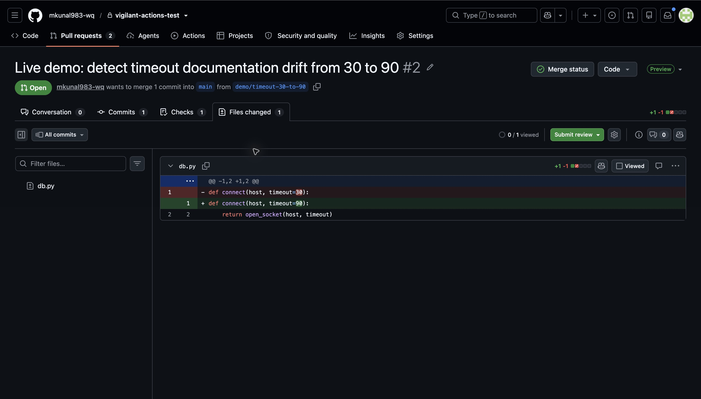
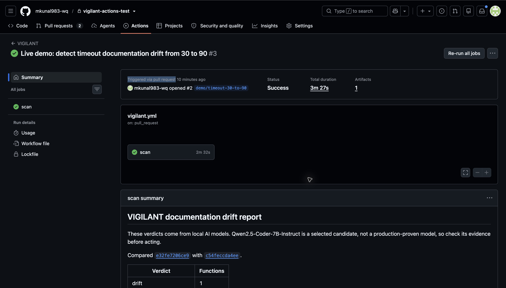
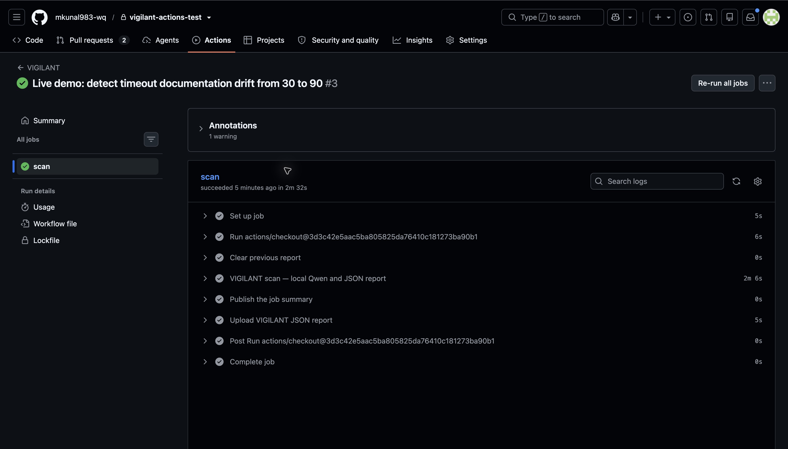
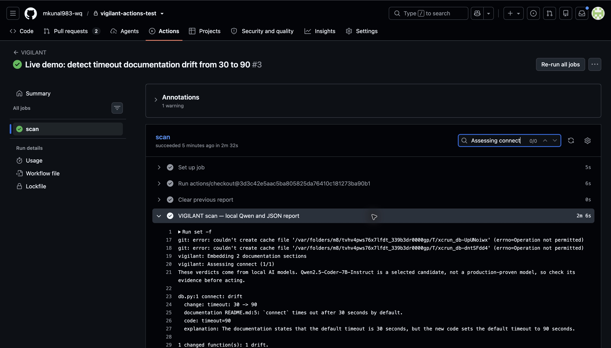
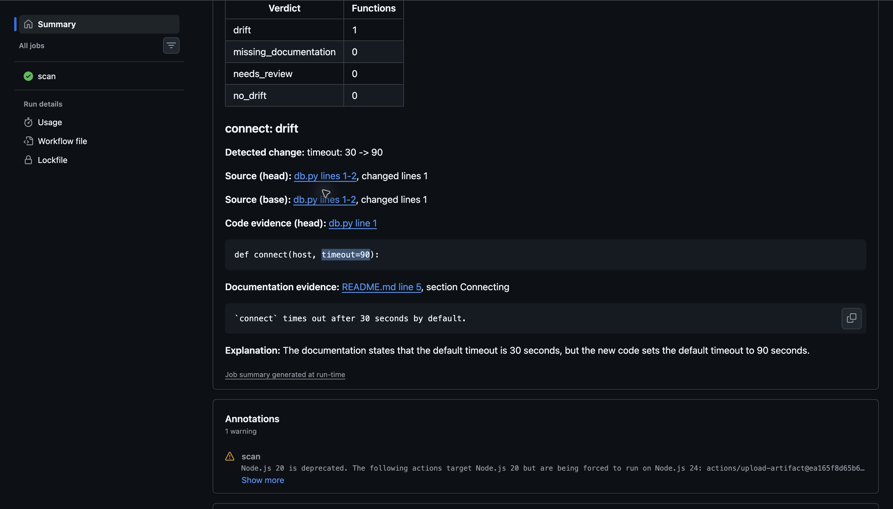
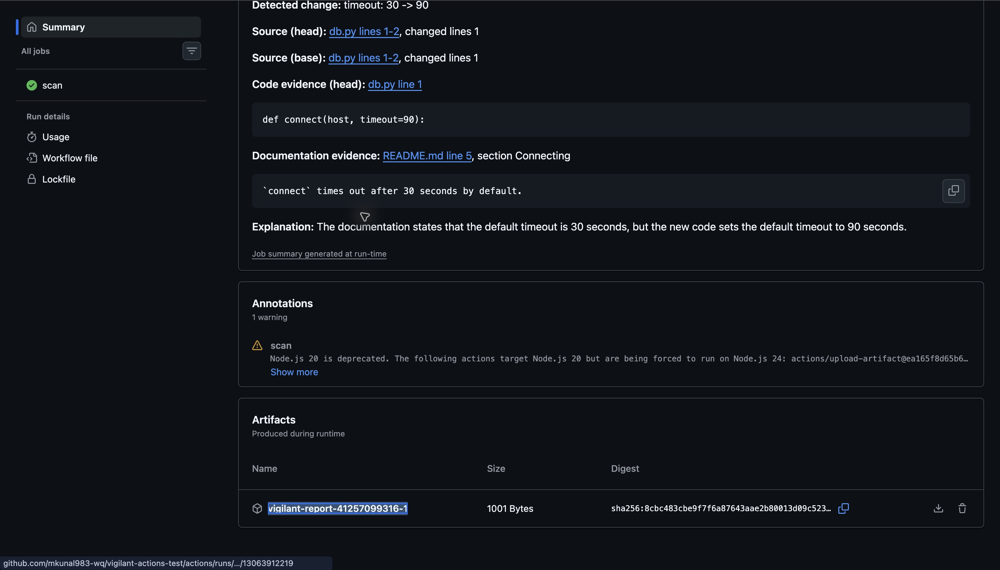

# Live GitHub PR scan: timeout documentation drift

On 1 November 2026, VIGILANT completed a real `pull_request` workflow in a private demo repository using local Qwen models. It detected **one documentation drift finding**: the code changed the default timeout from **30 to 90 seconds**, while the README still said **30 seconds**.

This folder preserves the actual screenshots, downloaded JSON report, exact fixture, and workflow snapshot so reviewers can inspect the evidence without access to the private repository. Screenshots are captures of GitHub, not mockups. Browser framing may be cropped; report values have not been edited. Browser search highlighting appears in some captures.

## Traceability

| Item | Value |
| --- | --- |
| Demo repository | `mkunal983-wq/vigilant-actions-test` (private) |
| Pull request | [PR #2](https://github.com/mkunal983-wq/vigilant-actions-test/pull/2) |
| Workflow run | [41257099316](https://github.com/mkunal983-wq/vigilant-actions-test/actions/runs/41257099316), attempt 1 |
| Job | [124702474765](https://github.com/mkunal983-wq/vigilant-actions-test/actions/runs/41257099316/job/124702474765) |
| Base commit | `e32fe7206ce96580219f94fc8de44b7bd835f294` |
| Head commit | `c54feccda4ee7beead4f7cf13d2216155a3ac264` |
| Installed VIGILANT commit | `078f203275241f9586c1fc9817ca3e78c8478a84` (non-editable installation) |
| Result | Completed successfully; `drift: 1`; `source_verified: true` |
| Model inference | Qwen3-Embedding-0.6B retrieval; Qwen2.5-Coder-7B-Instruct reasoning |
| Artifact | `vigilant-report-41257099316-1`; retained on GitHub for 7 days |

Private links require repository access. The report is also preserved here after the hosted artifact expires. The screenshot title's **#3 is the workflow run number**, not the PR number; the triggering PR is **#2**.

## 1. The PR changes only code

Only `db.py` changed: `def connect(host, timeout=30):` became `def connect(host, timeout=90):`. README.md was unchanged. The exact input files are preserved in [fixture](fixture/); the Python snippets are stored as text because `open_socket` is only a placeholder, and the fixture is analyzed, never executed.

## 2. GitHub runs VIGILANT

The run was triggered by `pull_request`, completed successfully, and produced one artifact. A green check means the scan completed; it does **not** mean the documentation has no drift.

The steps explicitly include local Qwen scanning and JSON generation, publishing the Job Summary, and uploading the JSON report. [run-status.json](run-status.json) preserves the successful step statuses returned by GitHub.

## 3. The local model evaluates the changed function

The log shows `Embedding 2 documentation sections`, `Assessing connect (1/1)`, and `db.py:1 connect: drift`. It reports the change `timeout: 30 -> 90`, quotes README.md line 5, and cites `timeout=90` as code evidence. The engine reads Git revisions and parses source; this workflow does not install or execute the PR's Python code.

## 4. Evidence and explanation appear in the Job Summary

The summary links the before/after source at the exact commits and identifies:

- **Code:** `db.py`, line 1: `def connect(host, timeout=90):`.
- **Documentation:** `README.md`, line 5, section `Connecting`: “`connect` times out after 30 seconds by default.”
- **Explanation:** the documented default is 30 seconds, but the new code default is 90 seconds.

The [downloaded JSON](vigilant-report.json) records `status: completed`, `error: null`, `source_verified: true`, `verdict: drift`, the raw model response, exact line locations, retrieved sections and commit SHAs. Source verification checks evidence against the input; it does not prove general model accuracy. Recorded reasoning latency is 22.784 seconds, not the entire job duration.

## 5. The JSON is downloadable

The run contains `vigilant-report-41257099316-1`. [vigilant-report.json](vigilant-report.json) is the unmodified file downloaded from that artifact, rather than a manually constructed sample.

## Workflow and safety context

[workflow-snapshot.yml](workflow-snapshot.yml) is the exact demo workflow, preserved as evidence under `examples/`; it is not an active workflow in this repository. It uses a private-repository and same-repository PR guard, an owner/actor restriction, pinned action SHAs, read-only contents permission, disabled checkout credential persistence, and an `exec` scan process so cancellation reaches the scan. It does not use `pull_request_target`.

The actual job used a supervised macOS ARM64 ephemeral self-hosted runner under the existing sandbox profile. Only the reviewed, code-only PR was queued when the runner started. It automatically unregistered after the job; the post-run runner count was zero. This does not make arbitrary PR workflows safe: workflow changes can execute commands, and the personal-account sandbox is not a hardened security boundary. Follow the [runner setup and security gates](../github-actions/README.md) before reproducing the demo. Never attach the personal runner to the public upstream repository.

The public upstream's PR #7 ran its pytest CI workflow. The actual model scan shown here ran in the dedicated private demo repository. They are separate runs with different purposes.

## Visible warnings and limits

The screenshots preserve the real warnings: Git could not write its `xcrun` cache under the sandbox, and GitHub warned about the pinned upload action's Node.js 20 runtime while running it under Node.js 24. Neither prevented this run from completing or uploading its artifact. This evidence documents one successful fixture; it does not establish production accuracy or guarantee future runs.

To present: show the code-only PR diff, the completed scan steps, the evidence summary, then the JSON artifact. A fresh reproduction requires a reviewed PR and a new supervised ephemeral runner session.
